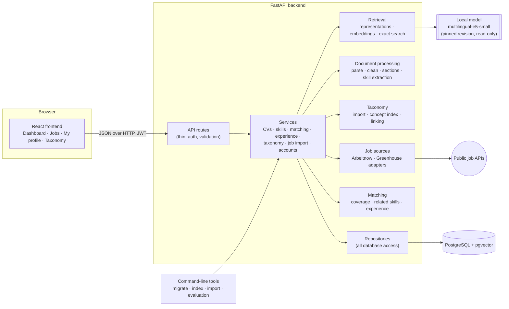
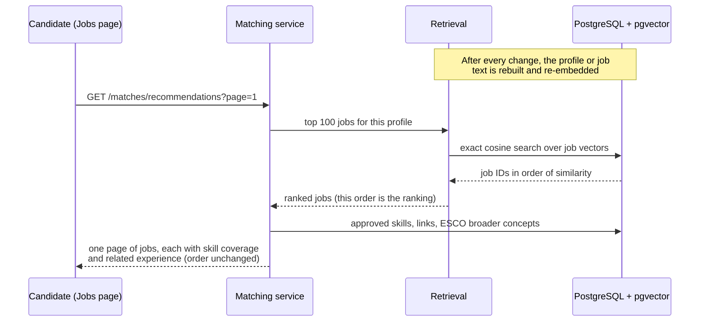

# Architecture

SkillGap is a web application with a React frontend, a FastAPI backend and a
PostgreSQL database with the pgvector extension. A local embedding model runs
inside the backend process; no external AI service is called. Taxonomies
(ESCO, O*NET) are stored locally as versioned releases.

## Components

The layers are strict: routes only check access and validate input, services
hold the logic, and repositories are the only code that touches the database.
Document processing, taxonomy linking, retrieval and matching are plain Python
modules that can be tested on their own.

| Part | Location | Role |
| --- | --- | --- |
| Frontend | `frontend/src` | Candidate pages (Dashboard, Jobs, My profile) and staff pages (Taxonomy, job management, live import, overview) |
| API routes | `backend/app/api/routes` | `/auth`, `/candidates`, `/cvs`, `/jobs`, `/matches`, `/retrieval`, `/taxonomy`, `/admin` |
| Services | `backend/app/services` | Business logic |
| Repositories | `backend/app/repositories` | Database access |
| Document processing | `backend/app/services` (parsing, cleaning, sections), `backend/app/nlp` | Text from PDF/DOCX/TXT, sections, skill extraction |
| Taxonomy | `backend/app/taxonomy` | Release import, in-memory concept index, linking, occupations |
| Retrieval | `backend/app/retrieval` | Text representations, embeddings, re-indexing, offline evaluation |
| Matching | `backend/app/matching`, `services/matching_service.py` | Skill coverage, required experience, work history |
| Job sources | `backend/app/job_sources` | Live job adapters, filtering, contact removal |
| Database schema | `backend/app/db` | SQLAlchemy models and Alembic migrations |

## Data flow

### From a CV to confirmed skills

1. The candidate uploads a file or pastes text and gives consent. The file is
   read in memory; only the extracted text is stored, never the file.
2. The text is cleaned and split into sections (skills, experience,
   education, ...).
3. Skills, tools, qualifications and experience indicators are extracted with
   a curated dictionary and rules. Each occurrence keeps the sentence it came
   from as evidence.
4. Each extracted term is linked to the active ESCO release: exact preferred
   label, exact alternative label, normalized match, then fuzzy match. A link is
   approved automatically only when one concept is the clear best match with a
   confidence of at least 0.95; all other suggestions stay open for review.
5. The candidate confirms, rejects or corrects skills and their links, and can
   add skills by hand. Only confirmed skills are used for matching. Rejected
   skills are kept as decisions but never used.

### From a job posting to job skills

Jobs are added by staff or imported from public job APIs. Imported postings
are converted from HTML to text, kept only if they are in English and located
in Europe or remote, stripped of e-mail addresses, phone numbers and contact
names, and checked for duplicates (same posting ID or same text). Extraction
for jobs also reads requirement headings ("Required", "Nice to have"),
experience ranges ("3+ years") and filtered ESCO skill labels. It splits skill
lists in requirement sections into short items, recognises languages with a
proficiency cue and named certifications, and leaves out generic words and
text about the company, benefits, equal opportunity, privacy and the
application process. The same linking rule applies, except that a short
acronym found by these list rules links only to a label spelled the same way
and is never approved automatically. The rule set is versioned
(`JOB_EXTRACTION_VERSION`); CV extraction does not change with it, except
that CVs always use the language rule (`language_rule@v4`): language names
with a proficiency cue, or listed under a "Languages" heading, become
"language" items for the candidate to confirm. Live jobs that have not been seen at their source for 14 days
(configurable) are archived, and a cap keeps at most 1,500 active live jobs,
with at most 70 % from one source.

### Retrieval and explanation

- **Representations.** A candidate profile is turned into text from its
  confirmed skills. A job is turned into text from its title and its required
  and preferred skills and duties, within the model's 512-token limit. Both are
  embedded with `intfloat/multilingual-e5-small` (384 dimensions) at a pinned
  revision. The model name, revision and template version are stored with
  every vector.
- **Re-indexing.** When skills, links, CVs or jobs change, the affected
  profiles and jobs are re-embedded automatically after the database commit.
  The search only uses vectors that are current.
- **Ranking.** The top 100 jobs by cosine similarity are the ranking, shown in
  pages. Similarity values are not shown and not combined with anything.
- **Explanation.** For the jobs on the requested page only, each job skill is
  classified as *matched* (same ESCO concept or same name as a confirmed
  skill), *related* (a confirmed skill shares a specific ESCO parent concept)
  or *missing*. On live jobs, skills nobody reviewed count but are marked as
  automatically extracted. Qualifications, certificates and similar
  terms are listed as "not assessed".
- **Languages.** A job's language items are compared by name with the
  candidate's confirmed languages ("in your profile" / "not found in your
  profile"), without levels, in a separate group that is not part of the skill
  counts. Profile languages (found by the language rule or added on My
  profile, optional level in `candidate_skills.proficiency_level`) are left out
  of the profile embedding and the skill coverage, so they never affect the
  order. Skills typed as "language" in the skill editor before this keep their
  earlier behaviour. Without a confirmed language the job's languages stay
  "not assessed".
- **Experience.** If the candidate entered work experience, the years in roles
  of the same 3-digit ISCO group as the job are compared with the job's stated
  minimum. This is shown next to the job and can, at the candidate's request,
  hide jobs above their experience. It never changes the order.
- **Nothing is stored per request.** Rankings and explanations are computed on
  read from the current data.

### Start-up

The backend first checks that the database schema matches the migrations in
the code and stops if it does not; migrations are run only by the separate
`migrate` command. It then prepares job data for the freshness check in a
background thread, which pauses while requests are being served.

## Access control

| Role | Can use |
| --- | --- |
| Candidate | Own CVs, skills, work entries, Jobs page, Dashboard, account deletion |
| Researcher | Taxonomy import, search and link review; job management and skill review; processing logs |
| Administrator | Everything a researcher can, plus live job import and the system overview |

Job rankings and explanations are available only to the candidate they belong
to; staff accounts cannot request them. The system overview shows totals only.

## Data model (main tables)

| Area | Tables |
| --- | --- |
| Accounts | `users`, `roles`, `user_roles`, `refresh_tokens` (stored as hashes) |
| Candidates | `candidate_profiles`, `cv_documents`, `cv_sections`, `extracted_candidate_terms`, `candidate_skills`, `candidate_work_entries`, `candidate_preferences` |
| Jobs | `jobs`, `job_sections`, `extracted_job_terms`, `job_skills` |
| Taxonomy | `taxonomy_sources`, `taxonomy_versions`, `taxonomy_concepts`, `taxonomy_labels`, `taxonomy_relationships`, `occupations`, `onet_data_records`, `esco_onet_mappings` |
| Linking and review | `taxonomy_link_candidates`, `approved_taxonomy_links`, `taxonomy_review_events` |
| Retrieval | `candidate_profile_embeddings`, `job_embeddings`, `occupation_label_embeddings` |
| Operations | `processing_logs` |

Every schema change is an Alembic migration in
`backend/app/db/migrations/versions`.

## Offline evaluation

The retrieval benchmark (8 candidate profiles, 30 jobs, human relevance
judgments) is kept outside the repository. The command-line tools in
`app/retrieval/cli.py` (`evaluate`, `compare-matching`) score rankings against
it. The 30 evaluation jobs are marked as their own source and are never shown
to candidates or mixed with live jobs, so live imports cannot change the
evaluation results. See [evaluation.md](evaluation.md).
